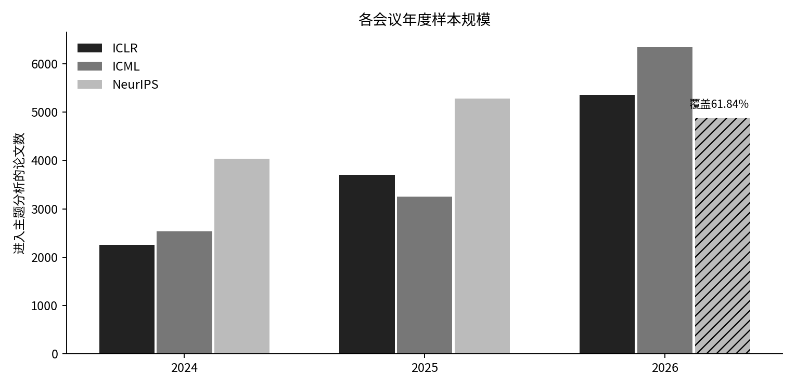
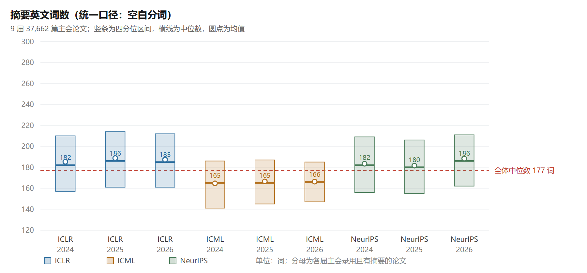
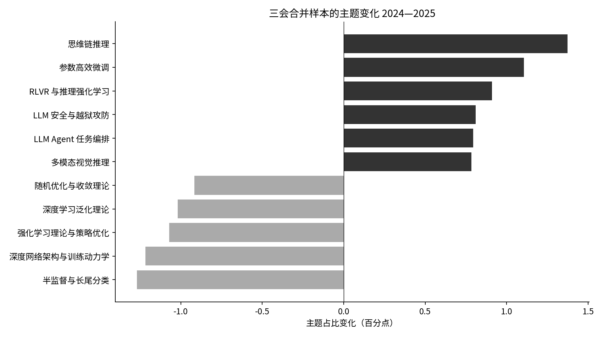
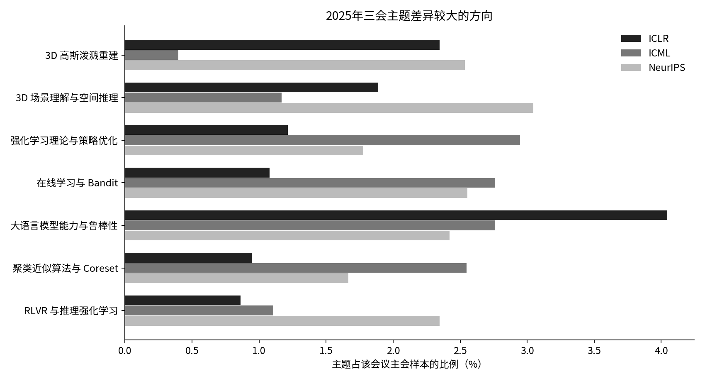
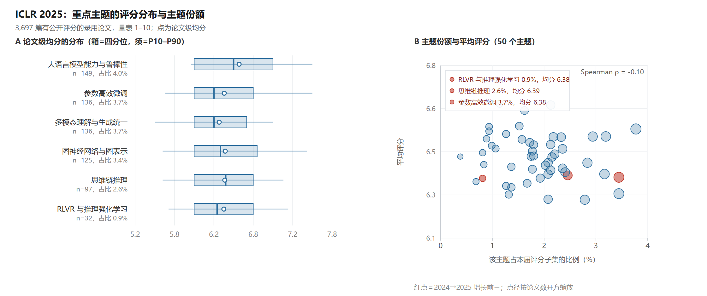

# 补充轮结果表与图

两个来源：**交付件原样导出**（7 张表 + 3 张图，逐格复算）和**本项目重算**（3 张表 + 2 张图，其中图 2 在原图基础上重绘）。共 10 张表、5 张图。交付原件以 ASCII 文件名 `supplement_results_2026-11-20.xlsx` 挂在 Release [`scores-2026-11-20`](https://github.com/lindsayo11/aipaper/releases/tag/scores-2026-11-20)（292,428 B，SHA256 `52907d69e3339f9d7aaadb653aea1120c2304b6a7e58d6d04b48fe665715d002`）。

## 表

| 文件 | 行数 | 来源 | 回答什么 |
| --- | ---: | --- | --- |
| `tables/sample_scale.csv` | 9 | 导出 | 逐届规范化记录、主会分析样本、参考录用数与覆盖比例；2026 三会因 NeurIPS 覆盖 61.84% 不纳入同期比较 |
| `tables/field_completeness.csv` | 10 | 导出 | 标题/摘要/作者/关键词/OpenReview 标识在 43,702 条与 37,662 篇中的缺失 |
| `tables/abstract_length.csv` | 10 | **重算** | 逐届与全体摘要词数（均值、中位数、四分位、P95），口径统一为空白分词 |
| `tables/topic_change_common_years.csv` | 50 | 导出 | 三会合并 2024→2025 的主题占比变化、篇数变化、三会等权变化 |
| `tables/topic_venue_difference.csv` | 50 | 导出 | 2025 年三会各自的主题占比与最高占比会议 |
| `tables/topic_year_detail.csv` | 450 | 导出 | 9 届 × 50 主题的论文数与主题占比（含分母） |
| `tables/score_coverage.csv` | 7 | 导出 | 有公开评分的 7 届：主会样本、评分表样本合计、未计入数、量表 |
| `tables/iclr_public_submission_rates.csv` | 150 | 导出 | ICLR 三届 × 50 主题的公开投稿、录用/拒稿/撤稿/直接拒稿与条件接收率 |
| `tables/topic_change_stability.csv` | 50 | **重算** | 去掉低相似度论文后的占比变化，与全样本排名并列 |
| `tables/topic_score_distribution.csv` | 50 | **重算** | ICLR 2025 各主题的评分分布（n、均分、标准差、P10–P90）与主题份额 |

## 图

3 张来自交付件、2 张本项目重绘，路径相对本文件，GitHub 上直接渲染。

**图 1　各会议年度进入分析的论文数**（交付件）——2026 NeurIPS 只有 61.84% 覆盖，故不进入三会横向比较。



**图 2　摘要英文词数分布**（重绘，空白分词口径）——竖条为四分位区间，横线为中位数，圆点为均值；全体中位数 177 词。



**图 3　三会合并样本的主题占比变化 2024→2025**（交付件）——思维链推理 +1.37 pp 居首。



**图 4　2025 年主题占比的会议差异**（交付件）——如 3D 高斯泼溅重建在 NeurIPS 2.53%、ICLR 2.35%、ICML 0.40%。



**图 5　ICLR 2025 重点主题的评分分布与份额**（新绘）——左：六个主题的论文级均分箱线；右：50 个主题的份额–均分散点，红点为增长前三。



## 摘要长度：为什么换口径

交付表用的是正则分词，该实现没有随项目保留；此前仓库用空白分词复算，ICLR 2024 均值 185.21 对不上表里的 187.21，全体中位数也是 177 对不上图里的 179。**两套数字不能同时进报告**，因此统一为可复算的一种：

```
英文词数 = len(abstract.split())   # 空白分词
```

- ICLR 2024 均值：187.21 → **185.21**；全体 37,662 篇中位数：179 → **177**（四分位 153–202）
- 表与图都由 `scripts/build_supplement_analysis.py` 生成，报告只引用这一组数字；导出脚本不再写这张表，避免两个写入方
- 交付表的原值保留在 Release 附件里，需要对照时可查

## 稳健性：去掉低相似度论文

模型给每篇论文打了与主题中心的相似度，并把最低的一批标为 `outlier=True`（1,884 篇，占 5.0%）。剔除后分母同步缩小（8,830→8,360、12,253→11,654），重算 2024→2025 占比变化：

| 主题 | 全样本 | 去低相似度 |
| --- | ---: | ---: |
| 思维链推理 | +1.37 pp | **+1.39 pp** |
| 参数高效微调 | +1.11 pp | **+1.17 pp** |
| RLVR 与推理强化学习 | +0.91 pp | **+0.95 pp** |

**前三名与顺序不变**；第 4、5 名互换（LLM 安全与越狱攻防 4→6，LLM Agent 任务编排 5→4）。结论只说"头部稳健"，不外推到整张 50 行表的排序。

## 评分分布与差异（ICLR 2025）

选 ICLR 2025：3,697 篇有公开评分（覆盖 99.7%），量表 1–10，逐篇评分齐全。全会论文级均分 6.46、标准差 0.67。

| 主题 | 篇数 | 占比 | 均分 | 标准差 | 四分位距 |
| --- | ---: | ---: | ---: | ---: | ---: |
| 大语言模型能力与鲁棒性 | 149 | 4.03% | 6.57 | 0.68 | 1.00 |
| 参数高效微调 | 136 | 3.68% | 6.38 | 0.72 | 0.75 |
| 多模态理解与生成统一 | 136 | 3.68% | 6.32 | 0.62 | 0.67 |
| 图神经网络与图表示 | 125 | 3.38% | 6.39 | 0.70 | 0.80 |
| 思维链推理 | 97 | 2.62% | 6.39 | 0.69 | 0.75 |
| RLVR 与推理强化学习 | 32 | 0.87% | 6.38 | 0.69 | 0.75 |

- **论文多不等于分数高**：50 个主题的份额与均分 Spearman ρ = **−0.10**；最大的主题（149 篇）6.57 分，与 136 篇的多模态主题 6.32 分差 0.25，六个主题全部落在 6.32–6.57 的窄带内，与全会均值 6.46 的偏离不超过 0.11。
- **增长快的主题并不更分散**：思维链推理、参数高效微调、RLVR 的标准差 0.69–0.72，与全会 0.67 基本一致；差异体现在份额变化上，不在评分分布形状上。
- 评分只描述公开评审的分数分布，不构成录用概率、主题质量或因果结论；跨会议/年份量表不同，未合并。

## 复算状态

`verification.json` 记录交付表的逐格复算（关键列逐行比对）：

| 表 | 状态 | 比对规模 |
| --- | --- | --- |
| 数据规模 | 一致 | 9 行 × 3 列 |
| 字段完整性 | 一致 | 10 行 × 2 列 |
| 共同年份变化 | 一致 | 50 行 × 5 列（含占比变化逐值） |
| 会议主题差异 | 一致 | 50 行 × 4 列 |
| 主题年度明细 | 一致 | 450 行 × 2 列 |
| 评分覆盖 | 一致 | 7 行 × 4 列（对齐 `data/scores/`） |
| ICLR公开投稿 | 一致 | 150 行 × 6 列（对齐 `iclr_topic_rates_results.zip`） |

`analysis.json` 记录重算三张表的输入、过滤条件与结果（含 `top3_order_unchanged`、`spearman_share_vs_mean`、全会评分均值与标准差）。`manifest.json` 只登记从交付件导出的 7 表 3 图（含各自 SHA256），重算的 3 表 2 图以 `analysis.json` 为准。

## 再生成

```bash
python scripts/export_supplement_tables.py --xlsx <项目数据分析补充结果.xlsx>   # 导出 7 表 + 3 图并复算
python scripts/build_supplement_analysis.py                                    # 重算 3 表 + 2 图
```

后者用内联 SVG 生成图，再调本机 Edge 无头模式栅格化为 PNG（无第三方绘图库依赖）。

## 边界

- 这些是录用成果的分布，不能反推投稿分布，也不能推出"选这个主题更容易中"。
- 主题编号只在本后端（onnx / MiniLM）内有意义，跨模型不可对齐；命名只描述主题内容。
- 2026 只做单届描述，不进入 2024–2025 的三会横向比较。
